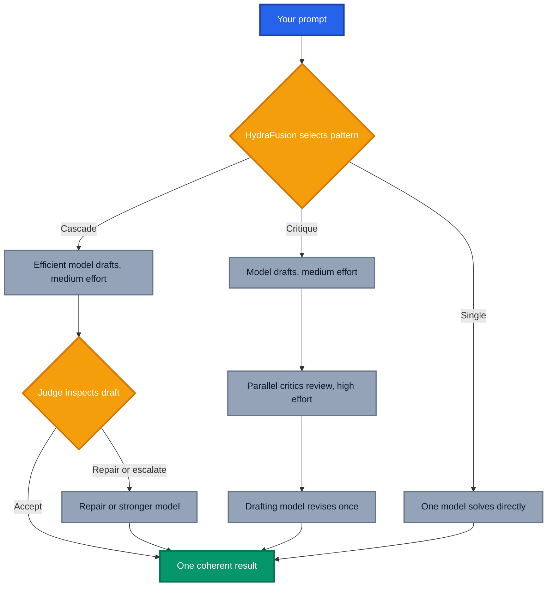

Open the model picker in GitHub Copilot today and you feel a bit like Uncle Owen at the Jawa sandcrawler. A long line of models, Claude, GPT, Opus, Sonnet, Haiku, Sol, Luna, Astra, each promising to be exactly what you need, and no easy way to tell which one has a bad motivator until it is too late. Picking the right one for the job has quietly become a job in itself.

[**HydraFusion**](https://github.blog/ai-and-ml/github-copilot/project-hydrafusion-frontier-quality-via-multi-model-orchestration/){:target="\_blank" rel="noopener"} is GitHub's answer to that problem. It orchestrates multiple models at runtime in GitHub Copilot, picking the models and the workflow for you, task by task. It is currently in **research preview**, an early access stage similar to a private preview, so expect rough edges and frequent change. I have been putting it through its paces, and with the new [**HydraFusion Max**](https://github.blog/changelog/2026-10-14-hydrafusion-updates-and-new-max-option/){:target="\_blank" rel="noopener"} option landing this week, this post covers what it is, how it changed my workflow, when to reach for Max, and the one thing I wish I had done before I started.

## The Real Problem: Model Fatigue

One of the biggest challenges with AI assisted development right now is not capability, it is **choice**. There are so many models available that working out which one suits a task has become genuinely difficult, and the list keeps growing.

The natural human response is to stop choosing. You find a model or two that have never let you down, your safety models, and you use them for everything. I am as guilty of this as anyone. It feels efficient, but it means you rarely venture out to discover that a different model would have done the job better, faster or cheaper.

That is model fatigue. Not a lack of options, but too many of them, and no time to properly evaluate each one against the work you actually do.

## My Manual Workaround

Before HydraFusion, I had settled into a pattern that I suspect plenty of you follow too:

1. **Research and planning** with a heavyweight reasoning model such as Claude Sonnet or Claude Opus
2. **Execution** with a lower tier, lightweight model such as GPT Luna, once the plan was solid
3. **Review** by eyeballing the output myself, and occasionally asking a second model for a sanity check

It works. The expensive model does the thinking, the cheap model does the typing. But it is manual. I had to remember to switch models at the right moment, and occasionally I would forget and burn premium reasoning on simple tasks.

HydraFusion now does this for me automatically, and that is the headline for me.

## What Is HydraFusion?

HydraFusion is a runtime model orchestrator in GitHub Copilot. You select it in the model picker, but it is not a model. Behind the scenes it chooses an execution pattern, a reasoning effort and the models that run each step, then returns a single response.

It builds on [Auto model selection](https://docs.github.com/copilot/concepts/models/auto-model-selection){:target="\_blank" rel="noopener"}, which matches your task to a suitable model. HydraFusion goes a step further. It does not just choose **which** model, it chooses **how** the models work together.

GitHub's framing is that developers already coordinate models manually, choosing one for a task, asking another to review, escalating hard problems to something stronger. HydraFusion moves that process into the runtime. That is almost word for word my workaround above, which is probably why it clicked so quickly.

### Research Preview Means Early Access

Being in research preview matters. GitHub states there is **no SLA**, it is **not intended for production workloads**, and the execution patterns and models can change during the preview. Treat it like any private preview, great for exploring and giving feedback, not something to build critical processes around yet.

### How to Try HydraFusion

HydraFusion and HydraFusion Max are available in Copilot CLI, VS Code and the GitHub Copilot app on Copilot Pro, Pro+, Business and Enterprise plans, with experimental or preview features enabled and subject to your organisation's model policies.

In [GitHub Copilot CLI](https://docs.github.com/copilot/how-tos/copilot-cli/use-copilot-cli/overview){:target="\_blank" rel="noopener"}:

```bash
copilot update
copilot --experimental
```

Then enter `/model` and pick **HydraFusion (Research Preview)** or **HydraFusion Max (Research Preview)**. In VS Code 1.140 or later, turn on the `chat.copilot.hydraFusion.enabled` setting. In the Copilot app, turn on HydraFusion under **Settings**, **Experimental**.

You are billed for each underlying model at its [standard rate](https://docs.github.com/en/copilot/reference/copilot-billing/models-and-pricing){:target="\_blank" rel="noopener"}. There is no separate HydraFusion charge, but the Auto discount does not apply, so the workflow it chooses directly affects what you pay.

## Understanding the HydraFusion Execution Patterns

This is the section I wish someone had made me read first.

When I started using HydraFusion, I saw labels like **single**, **cascade** and **critique** appear in my sessions and honestly had no idea what they meant. I was using it without understanding how it was processing my work behind the scenes, which made it hard to judge whether it was doing a good job.

For each prompt, HydraFusion chooses one of three execution patterns:

- **Single**, one model completes the task. It behaves much like a normal request to one model.
- **Cascade**, an efficient model drafts a solution, then a judge inspects the draft and either accepts it, requests a repair or escalates to a stronger model.
- **Critique**, one model drafts while multiple critics from other models review it in parallel. Their feedback is aggregated and the drafting model revises once.

Reasoning effort is now tailored per step too, medium for drafts and high for reviews. The critique pattern resembles [Rubber Duck in Copilot CLI](https://docs.github.com/en/copilot/concepts/agents/copilot-cli/rubber-duck){:target="\_blank" rel="noopener"}, and a second opinion from a different model is far more useful than asking the same model to mark its own homework.



The way I now think about them:

- **Single** is a Jedi Master handling it solo
- **Cascade** is sending the Padawan first, with a Master checking the work and stepping in if things go sideways
- **Critique** is the Padawan doing the work and the Jedi Council reviewing it before it ships

Once that clicked, the session output became far more meaningful. I could see **why** a task took longer, or why a seemingly simple request triggered a review step. My advice is simple: **spend the time to understand the execution patterns** before you judge HydraFusion.

HydraFusion shows each step as it works but holds back intermediate drafts, because they might be revised or discarded, and returns one final response. Knowing the patterns makes that wait far less mysterious.

## HydraFusion vs HydraFusion Max: When to Use Each

The October update refreshed the model pool to include Claude Opus 5.5, GPT-6 Astra, GPT-6.1 Sol and GPT-6 Luna, optimised the cascade and critique workflows, and introduced **HydraFusion Max**.

Max uses the same architecture and workflow techniques, but is tuned for frontier capability on demanding tasks. It applies higher reasoning effort, including extra high, where depth matters most, while still using orchestration to consider token efficiency.

| Option          | Best for                                                                    |
| --------------- | --------------------------------------------------------------------------- |
| Auto            | Everyday work and quick, routine tasks                                      |
| HydraFusion     | Substantial, well scoped tasks such as a complex bug or a multi file change |
| HydraFusion Max | Tasks needing the deepest reasoning and most thorough analysis              |

My rule of thumb:

- **Stay on Auto** for quick questions, small edits and routine work, where review passes add time and cost for little gain.
- **Use HydraFusion** as the default for real engineering tasks, where a judge or critics catching mistakes is worth a little extra time.
- **Reach for Max** when being wrong is expensive, think gnarly architectural refactors, subtle concurrency or security bugs, or analysis across a large, unfamiliar codebase.

Max is the Millennium Falcon making the Kessel Run, impressive when you need it, but you do not fly it to the corner shop. Deeper reasoning means more tokens, so do not leave it selected by default.

## Guardrails Worth Knowing

GitHub built HydraFusion around principles such as complete cost accounting across every step, bounded execution with explicit timeouts, and validated routing that checks model bindings and availability before execution starts.

One limitation deserves attention. Critique now uses tools to inspect your workspace directly, and if HydraFusion discards a draft, file edits that draft already made **are not undone automatically**. Review changes before you commit them, which is good practice with any agent anyway.

## What the Launch Benchmarks Say

At launch, GitHub evaluated HydraFusion offline across three agentic coding benchmarks against Claude Opus 5:

| Benchmark         | Cost vs. Opus 5 | Quality vs. Opus 5 |
| ----------------- | --------------- | ------------------ |
| TerminalBench 2.1 | 67% lower       | +4.9 points        |
| DeepSWE           | 36% lower       | -1.5 points        |
| CheckpointBench   | 65% lower       | -0.1 points        |

That is roughly frontier quality at a fraction of the estimated cost. These are controlled offline results that predate the October update, so treat them as a promising signal rather than a guarantee for your workload.

## My Experience: The Good and the Not Yet

### What Works Well

The biggest win is that I have **stopped thinking about models**. I describe the task, HydraFusion decides whether it needs a review pass or a quick single shot, and I focus on the outcome. The research then execute split I used to manage by hand now just happens.

It has also nudged me out of my safety model habit. Seeing different models used for different tasks has made me more curious about what each one is actually good at.

### Where It Is Still Learning

It is not perfect yet. I noticed HydraFusion defaulting to heavier models such as **GPT-6.1 Sol** even for fairly basic tasks, the kind of work I would happily have given to a lightweight model. That is more horsepower, and potentially more cost, than the task needed.

I suspect this will improve. It is a research preview, and GitHub says routing will be refined using real developer workloads. Right now it errs on the side of quality, which is the right side to err on, but keep an eye on your usage.

### Tips for Getting Started

- **Start with first turn, single prompt tasks.** GitHub notes these are the sweet spot today.
- **Learn the execution patterns first.** Knowing single, cascade and critique turns confusing output into useful insight.
- **Match the option to the task.** Auto for routine work, HydraFusion for substantial tasks, Max for the hardest problems.
- **Watch your usage.** Run `/usage` in Copilot CLI to see AI credits per model.
- **Share feedback.** Use `/feedback` in Copilot CLI or the [HydraFusion GitHub Community discussion](https://github.com/orgs/community/discussions/206492){:target="\_blank" rel="noopener"}.

## Conclusion: From Choosing Models to Orchestrating Them

HydraFusion tackles a problem that has crept up on all of us. Model fatigue is real, and falling back to the same safe models leaves value on the table. By orchestrating models through single, cascade and critique patterns, HydraFusion automates the research, execute and review rhythm many of us were already following by hand, and Max adds a gear for the hardest problems.

It is still in research preview, routing occasionally reaches for more power than a task needs, and the patterns take a moment to understand. But the direction is clear, moving from **choosing the best model** to **constructing the best way to solve each task**. I am happy to let it hold the model picker for a while.

_Have you tried HydraFusion or HydraFusion Max yet? Which execution pattern does it pick most for your work, and has it cured your model fatigue? Share your experiences in the comments._
