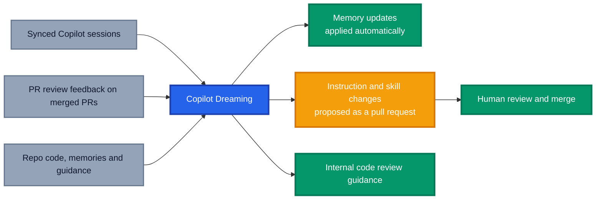

Every repository I work in has a `copilot-instructions.md` file that was perfect the day I wrote it. Six months later it is a bit like the Death Star plans in a droid's memory banks, technically valuable, but nobody is quite sure if they are still current. The test command has changed, the folder structure has moved, and Copilot is still cheerfully following guidance from a previous era.

**GitHub Copilot Dreaming** is GitHub's answer to that slow drift. It works in the background to keep Copilot's memories and repository guidance up to date, so your AI context does not quietly rot while you are busy shipping. It is in **public preview and subject to change**, so treat everything here as an early look rather than a final word.

This post covers what Copilot Dreaming is, the problem it solves, and real world scenarios where it will earn its keep.

## The Problem: AI Context Goes Stale

We have all been feeding Copilot more context: instruction files, custom agents, skills and memories. I wrote about [organising GitHub Copilot customisations at scale](https://azurewithaj.com/organising-copilot-customisations/) because the sprawl was becoming real.

The catch is that context is only useful while it is accurate. In practice, a few things keep happening:

- **Stale instructions**: repository guidance describes commands, tools or conventions the team has moved on from
- **Drifting memories**: facts Copilot learned months ago no longer match the codebase
- **Duplicate memories**: the same fact gets captured more than once, adding noise
- **Lost review feedback**: reviewers leave the same comments on pull request after pull request, but that knowledge never makes it back into the guidance Copilot uses

None of these are dramatic failures, they are paper cuts. But an assistant working from outdated context will confidently do the wrong thing.

## What Is GitHub Copilot Dreaming?

Copilot Dreaming is a background process that **analyses eligible Copilot sessions and pull request review feedback** to identify useful information, correct outdated guidance and remove duplicate memories. The [docs](https://docs.github.com/en/copilot/concepts/prompting-and-context/copilot-dreaming) give a nice simple example: it can propose an update when your repository's instructions describe an obsolete test command.

A few things worth calling out:

- **It updates context, not the model.** The underlying AI model is unchanged.
- **It runs in the background.** You do not need to keep a Copilot conversation open for it to run.
- **It builds on Copilot Memory.** Memory stores repository facts and personal preferences Copilot learns and reuses, even when Dreaming is off. Dreaming is the housekeeper keeping them relevant and accurate. If you are new to Memory, my post on [GitHub Copilot's agentic memory](https://azurewithaj.com/github-copilot-agentic-memory/) is a good primer.

## The Three Copilot Dreaming Capabilities

Dreaming is made up of three capabilities, each with different inputs and outputs.

| Capability                | Information it uses                                          | Output                                                                            |
| ------------------------- | ------------------------------------------------------------ | --------------------------------------------------------------------------------- |
| Repository customisation  | Eligible repository sessions, code, memories and guidance    | Updated repository memories and proposed instruction or skill changes             |
| Personal memory curation  | Your eligible sessions and personal memories                 | Updated personal memories, with no changes to personal instruction or skill files |
| Code review customisation | Feedback on merged pull requests and current repository code | Guidance for future Copilot code reviews                                          |

Repository customisation can review tracked `.github/copilot-instructions.md`, `.github/instructions/**`, `.github/agents/**`, `AGENTS.md`, `CLAUDE.md`, `GEMINI.md`, `REVIEW.md` and `.github/skills/**` files. It will not necessarily change every file, and which instructions, skills and memories Copilot uses depends on the Copilot feature.

## How Copilot Dreaming Applies Changes

This is the part I paid the most attention to, because "AI rewrites my instructions in the background" could go very well or very badly. GitHub has split it by risk.



1. **Memories** are added, updated and deleted automatically, without approval for each change.
2. **Checked in instructions and skills** are proposed in a pull request. Your files stay unchanged until you merge it.
3. **Code review guidance** is updated internally without a pull request. It complements the checked in instruction files that Copilot code review also uses.

The pull request path matters most to me. **AI generated guidance can be incorrect**, so review proposed changes before merging, exactly as you would a teammate's pull request. Not every run makes changes or opens a pull request, so silence is not necessarily a problem.

## Real World Scenarios for Copilot Dreaming

These are illustrative scenarios based on what the capabilities are designed to do, not documented case studies.

### Scenario 1: The Obsolete Test Command

Picture a platform team that migrated their test tooling months ago. The `.github/copilot-instructions.md` file still says `npm test`, but the team now runs `pnpm test`. Every agent session starts with the wrong command.

With **repository customisation**, Dreaming can spot the mismatch from eligible sessions and the repository code, then open a pull request proposing the updated instruction. A human reviews the diff, merges it, and the paper cut is gone.

### Scenario 2: The Cluttered Memory Bank

Imagine a Bicep repository that has been around for a couple of years. Copilot Memory has picked up the naming convention three times in slightly different words, and one memory still references a module layout the team restructured last quarter.

Dreaming can **remove the duplicates and correct the outdated memory** automatically, no "memory spring clean" meeting required.

### Scenario 3: Review Feedback That Finally Sticks

Imagine a team where senior engineers keep leaving the same comment on merged pull requests, something like "use managed identity here instead of a connection string". The feedback is right, but it stays buried in pull request history.

With **code review customisation**, Dreaming uses feedback on merged pull requests and the current code to build guidance for future Copilot code reviews. Your reviewers stop repeating themselves, and their knowledge scales.

## Prerequisites and Enabling Copilot Dreaming

This is where the preview shows. There are a fair few boxes to tick.

### Availability

- Available on **eligible paid Copilot plans**, but **not Copilot Pro**
- The initial preview requires access to **GPT-6.1 Sol**, and the model must be allowed by policy
- **Not supported** on GitHub Enterprise Cloud with data residency
- All capabilities need permission under your applicable enterprise and organisation policies

### Settings per Capability

| Capability                | Memory setting                  | Dreaming setting                                                          | Session syncing |
| ------------------------- | ------------------------------- | ------------------------------------------------------------------------- | --------------- |
| Repository customisation  | Repository level Memory enabled | Organisation policy or personally owned repository settings               | Required        |
| Personal memory curation  | Personal Memory enabled         | Permitted by managed policies, where applicable, and enabled for the user | Required        |
| Code review customisation | Repository level Memory enabled | Organisation policy or personally owned repository settings               | Not required    |

Code review customisation also needs Copilot code review and its preview features enabled, and it **does not currently support self hosted runners**.

Each Dreaming setting enables whichever capabilities have prerequisites met within its scope, and you cannot toggle them individually.

**One gotcha to remember:** if Dreaming is already on and you later complete extra prerequisites, completing them alone does not activate the new capabilities. Turn Dreaming off and on again using the relevant setting.

### Session Syncing

Session syncing saves local sessions to your GitHub account, and it is on by default for Copilot CLI and the GitHub Copilot app, subject to policy.

If you get Copilot through an enterprise or organisation, the **"Store local sessions in the Cloud"** policy under **"Copilot CLI"** must be set to at least **"View from cloud"**. If it is disabled or unconfigured, sessions stay local.

If you previously switched off syncing by setting `remoteExport` to `false` in `~/.copilot/settings.json`, remove that setting or set it back to `true`:

```json
{ "remoteExport": true }
```

## Costs and Guardrails

Background processes are easy to forget about until the bill arrives, so do not skip this section.

### Costs

- Model usage is billed in **AI credits** as part of your existing Copilot usage, not as a separate line item
- Cost depends on processing and the number of enabled users and repositories, **including inactive repositories**
- **Every run uses AI credits**, even runs that make no changes
- Administrators can monitor AI credits usage, but attributing it to Dreaming needs a detailed usage report rather than the "AI usage" view

Before enabling Dreaming for more organisations in an enterprise, configure spending controls on the billing account. **Alerts alone do not stop usage**, a per user budget may not cover repository level app usage, and you cannot budget individual Dreaming app installations separately.

### Data and Controls

- Dreaming can use previously synced sessions, memories, repository content and pull request review feedback
- Turning off session syncing does not delete sessions that have already been synced
- Proposed instructions and skills in pull requests are visible to anyone with repository access
- To stop future runs, disable Dreaming at the relevant enterprise, organisation, personal or repository level, or choose **"Disabled everywhere"** at the enterprise level
- Turning off personal Dreaming does not stop runs for organisation owned repositories, and a run in progress may continue

The big one: **turning Dreaming off does not undo its changes.** It will not restore deleted memories, remove information it created or close its pull requests, and there is no option to undo a run. Manage memories in personal or repository settings, and pull requests the usual way.

## My Take on Copilot Dreaming

Context maintenance is the chore nobody puts in a sprint, and Dreaming tackles it where the drift happens. A few key insights:

- **The risk split is well judged.** Memory updates happen automatically, while checked in files go through a pull request, keeping humans in control of shared guidance.
- **Code review customisation is the sleeper hit.** Turning repeated reviewer comments into future review guidance is compounding value.
- **Scope it deliberately.** Inactive repositories still cost credits, so start with a handful of active ones.
- **Automatic memory deletion needs trust.** There is no undo, so watch repository memories closely at first.

Remember this is public preview, so prerequisites and behaviour could change. Check the docs before planning a rollout.

## Conclusion

GitHub Copilot Dreaming tackles a problem most of us quietly live with: stale AI context. It curates repository and personal memories, proposes instruction and skill changes through pull requests, and turns merged pull request feedback into better code reviews.

My advice is to start small. Pick a few active repositories, sort out session syncing and spending controls first, and treat every Dreaming pull request with the same scrutiny you would give any teammate's change. Done right, your Copilot context stays sharp without anyone babysitting it.

_Have you turned on Copilot Dreaming yet? Which capability are you most keen to try, or what guardrails are you putting in place first? Share your experiences in the comments._
